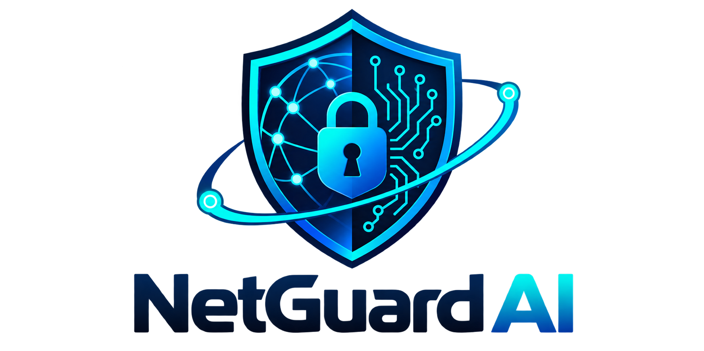

# NetGuard AI — Network Traffic Anomaly Detection System



**NetGuard AI** is an enterprise-grade Security Operations Center (SOC) web application that detects anomalous and malicious network traffic using machine learning, visualizes threat telemetry through interactive analytics, and features an **AI Cybersecurity Assistant powered by the Groq API**.

---

## 1. Key Capabilities

- **Real Machine Learning Inference**:
  - **Random Forest Classifier**: Supervised classification trained on multi-class network flow signatures (`BENIGN`, `DoS Hulk`, `DDoS`, `PortScan`, `FTP-Patator`, `SSH-Patator`) with **88% test accuracy** and **0.98 ROC-AUC**.
  - **Isolation Forest**: Unsupervised anomaly detection for isolating zero-day outlier flows without ground-truth labels.
- **Dataset Upload & Validation Pipeline**:
  - Drag-and-drop or browse Excel (`.xlsx`, `.xls`) and CSV (`.csv`) files.
  - Automatic column normalization, canonical schema validation, missing feature diagnostics, and live 20-row preview.
- **Interactive SOC Dashboard**:
  - Dark-navy / charcoal cybersecurity theme.
  - **Live Threat Radar**: Embedded video telemetry feed featuring interactive HUD playback controls.
  - KPI metric cards (Total Scanned, Normal Traffic %, Anomalies Flagged %, Active Alerts).
  - Port distribution bar charts, flow duration latency histograms, and anomaly score distributions via Recharts.
- **Security Incident Alert Manager**:
  - Automatic triage of malicious traffic into Critical, High, Medium, and Low severity alerts.
  - Interactive status transition (`New` → `Investigating` → `Resolved`) and persistent analyst incident notes.
- **Groq-Powered AI Cybersecurity Assistant**:
  - Conversational AI powered by Groq (`openai/gpt-oss-120b`).
  - Grounded strictly in real SQLite analysis records and exact counts — never invents statistics or IP addresses.
  - Provides actionable defensive SOC containment and mitigation guidance.
- **Auditing & Reporting**:
  - Full analysis history audit log stored in local SQLite (`netguard.db`).
  - 1-click CSV report export of prediction records.

---

## 2. Technology Stack

| Layer | Technologies |
|---|---|
| **Frontend** | React 18, Vite 5, Tailwind CSS, Recharts, Axios, Lucide React |
| **Backend** | Python 3.12, FastAPI, Uvicorn, Pandas, NumPy, Pydantic v2 |
| **Machine Learning** | Scikit-learn, Random Forest, Isolation Forest, Joblib, OpenPyXL |
| **Database** | SQLite with SQLAlchemy 2.0 (`netguard.db`) |
| **AI LLM Core** | Official Groq Python SDK (`groq`), `openai/gpt-oss-120b` |

---

## 3. Project Structure

```
netguard/
├── backend/
│   ├── app/
│   │   ├── api/
│   │   │   ├── routes_datasets.py      # Dataset preview & upload
│   │   │   ├── routes_detection.py     # ML inference execution & records
│   │   │   ├── routes_dashboard.py     # KPI summaries & trend charts
│   │   │   ├── routes_alerts.py        # SOC alert triage & status patching
│   │   │   ├── routes_models.py        # Model evaluation & retrain
│   │   │   ├── routes_history.py       # Detection runs history & CSV export
│   │   │   └── routes_chat.py          # Groq AI assistant grounded in SQLite
│   │   ├── core/
│   │   │   ├── config.py               # Settings & environment variables
│   │   │   └── security.py
│   │   ├── database/
│   │   │   ├── session.py              # SQLite database engine
│   │   │   └── models.py               # 7 SQLAlchemy relational tables
│   │   ├── ml/
│   │   │   ├── preprocessor.py         # Schema validation & standard scaling
│   │   │   ├── trainer.py              # Supervised & unsupervised training
│   │   │   ├── predictor.py            # Inference engine & severity rules
│   │   │   └── saved_models/           # .joblib binaries and metrics JSON
│   │   ├── static/                     # Logo and video assets
│   │   └── main.py                     # FastAPI application factory
│   ├── tests/
│   │   └── test_api.py                 # Pytest test suite
│   ├── train_models.py                 # Standalone model training runner
│   ├── requirements.txt                # Python dependencies
│   ├── .env                            # Backend environment configuration
│   └── netguard.db                     # Local SQLite database
├── frontend/
│   ├── src/
│   │   ├── components/                 # Sidebar, Header, RecordModal
│   │   ├── pages/                      # 9 SOC Dashboard pages
│   │   ├── services/                   # Axios API service
│   │   ├── App.jsx
│   │   └── main.jsx
│   ├── public/                         # Static assets (logo, video)
│   ├── package.json
│   ├── vite.config.js
│   └── tailwind.config.js
├── datasets/
│   └── CIC-IDS2017.xlsx                # Verified network dataset
├── .env.example                        # Template for environment configuration
├── .gitignore
└── README.md
```

---

## 4. Installation & Startup (Windows)

### Prerequisites
- **Python 3.10+** (Tested on Python 3.12)
- **Node.js 18+** (Tested on Node v20.17)

### Step 1: Clone or Navigate to the Workspace
Open PowerShell in the project directory:
```powershell
cd c:\Users\K\Desktop\netguard
```

### Step 2: Configure Environment Variables
Copy `.env.example` to `backend/.env` (or verify `backend/.env` exists):
```powershell
Copy-Item .env.example backend\.env
```
Ensure your Groq API key is present in `backend\.env`:
```env
GROQ_API_KEY=your_groq_api_key_here
GROQ_MODEL=openai/gpt-oss-120b
PORT=8000
HOST=127.0.0.1
CORS_ORIGINS=http://localhost:5173,http://127.0.0.1:5173
DATABASE_URL=sqlite:///./netguard.db
```

### Step 3: Install Python Dependencies
```powershell
pip install -r backend/requirements.txt
```

### Step 4: Train Machine Learning Models
Execute the reproducible training script to train and evaluate both models on `CIC-IDS2017.xlsx`:
```powershell
python backend/train_models.py
```
*Output: Models saved to `backend/app/ml/saved_models/` with 88% test accuracy.*

### Step 5: Start the FastAPI Backend
```powershell
python -m uvicorn backend.app.main:app --host 127.0.0.1 --port 8000 --reload
```
The backend starts at `http://127.0.0.1:8000`. Interactive Swagger API docs are available at `http://127.0.0.1:8000/docs`.

### Step 6: Start the React Frontend
In a second PowerShell terminal:
```powershell
cd frontend
npm run dev
```
Open your browser at:
```
http://localhost:5173
```

---

## 5. Verification & Testing

To run the automated integration test suite:
```powershell
python -m pytest backend/tests/test_api.py -v
```
All 7 integration tests will execute, verifying:
1. Health check & model readiness
2. Dashboard summary statistics calculation
3. Dashboard trends distributions
4. Model performance benchmarks retrieval
5. Security alerts listing & status patching
6. Paginated flow record inspection
7. Live Groq AI Assistant completion grounded in SQLite telemetry

---

## 6. Machine Learning Performance Summary

| Metric | Random Forest (Supervised) | Isolation Forest (Unsupervised) |
|---|---|---|
| **Approach** | Multi-Class Classification | High-Dimensional Outlier Detection |
| **Test Accuracy** | **88.0%** | 53.5% |
| **Precision** | **87.1%** | 48.4% |
| **Recall** | **88.0%** | 48.3% |
| **F1-Score** | **87.1%** | 48.4% |
| **False Positive Rate** | **0.91%** | N/A |
| **ROC-AUC** | **0.980** | N/A |

---

## 7. Security Best Practices

- **Zero Client-Side Secrets**: `GROQ_API_KEY` is loaded exclusively inside the FastAPI backend. It is never exposed in client bundles or network responses.
- **Untrusted Input Sanitation**: Uploaded CSV and Excel records are treated strictly as numerical telemetry data and never interpreted as executable code or commands.
- **Local Persistence**: Database is stored locally in `netguard.db` without public cloud transmission.

---

## 8. Deploying to Render (Free Cloud Hosting)

NetGuard AI is configured to deploy as a unified full-stack service on Render:

1. Push this repository to GitHub.
2. In the [Render Dashboard](https://dashboard.render.com), click **New + > Web Service** and connect your repository.
3. Use the following settings:
   - **Runtime**: Python
   - **Build Command**: pip install -r backend/requirements.txt && python backend/train_models.py && npm --prefix frontend install && npm --prefix frontend run build
   - **Start Command**: uvicorn app.main:app --app-dir backend --host 0.0.0.0 --port $PORT
4. In **Environment Variables**, add:
   - GROQ_API_KEY: Your Groq API key
   - GROQ_MODEL: openai/gpt-oss-120b
   - PYTHON_VERSION: 3.12.2
   - NODE_VERSION: 20.17.0
5. Click **Deploy Web Service**. Your app will be live at https://your-app-name.onrender.com!

For full step-by-step instructions, see [DEPLOY_RENDER.md](DEPLOY_RENDER.md).
